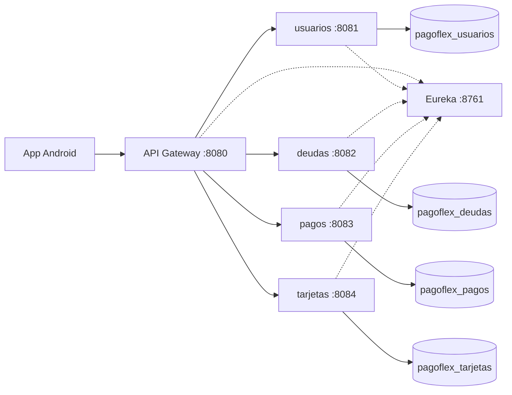

# PagoFlex Backend

Backend de **PagoFlex** construido con microservicios en Spring Boot. Cada microservicio tiene su propia base de datos MySQL y todos se levantan con Docker Compose. La app Android se conecta a un único punto de entrada: el API Gateway.

> Proyecto académico. Los pagos son una simulación: no hay cobros bancarios reales.

## Arquitectura



## Microservicios

| Servicio | Carpeta | Puerto | Base de datos | Responsabilidad |
|---|---|---|---|---|
| API Gateway | `getaway` | 8080 | - | Punto de entrada, enrutamiento y Swagger unificado |
| Eureka Server | `eureka` | 8761 | - | Registro y descubrimiento de servicios |
| Usuarios | `usuarios` | 8081 | `pagoflex_usuarios` | Registro, login JWT, recuperación de cuenta, perfil y foto |
| Deudas | `deudas` | 8082 | `pagoflex_deudas` | Deudas y cuotas |
| Pagos | `pagos` | 8083 | `pagoflex_pagos` | Registro e historial de pagos |
| Tarjetas | `tarjetas` | 8084 | `pagoflex_tarjetas` | Tarjetas de cada usuario |

MySQL corre en un contenedor y se expone en el puerto **3307** del equipo anfitrión.

## Tecnologías

- Java 21
- Spring Boot 4.1.2
- Spring Cloud 2025.1.4 (Gateway WebFlux y Eureka)
- Spring Security con JWT
- BCrypt para contraseñas
- Spring Data JPA
- MySQL 8.0
- springdoc OpenAPI (Swagger UI)
- Docker y Docker Compose
- JUnit

## Requisitos

- Docker Desktop (incluye Docker Compose)
- Git

No necesitas instalar Java, Maven ni MySQL: todo se construye dentro de los contenedores.

## Ejecución con Docker

```bash
git clone (https://github.com/emiliazx/pagoflex-backend)
cd pagoflex-backend
docker compose up -d --build
```

Comprobar que todo está arriba:

```bash
docker compose ps
```

En la primera ejecución, MySQL crea las cuatro bases de datos y el usuario `pagoflex` a partir de `mysql-init/init.sql`. Los servicios esperan a que MySQL esté saludable antes de iniciar. Los servicios pueden tardar unos segundos en registrarse en Eureka antes de que el gateway los enrute.

| Recurso | URL |
|---|---|
| Swagger unificado (gateway) | http://localhost:8080/swagger-ui.html |
| Panel de Eureka | http://localhost:8761 |

Comandos útiles:

```bash
docker compose logs -f deudas-service
docker compose up -d --build deudas-service
docker compose down
docker compose down -v
```

`down` conserva los datos. `down -v` borra también los volúmenes, es decir, las bases de datos.

## Documentación Swagger

Abre http://localhost:8080/swagger-ui.html y elige el servicio en el selector superior. Cada servicio también tiene su propio Swagger:

| Servicio | URL |
|---|---|
| Usuarios | http://localhost:8081/swagger-ui.html |
| Deudas | http://localhost:8082/swagger-ui.html |
| Pagos | http://localhost:8083/swagger-ui.html |
| Tarjetas | http://localhost:8084/swagger-ui.html |

Para probar endpoints protegidos:

1. Ejecuta `POST /api/usuarios/login` en el servicio **usuarios**.
2. Copia el valor de `token` de la respuesta.
3. Presiona **Authorize** e ingresa el token.

## Autenticación y roles

El login devuelve un JWT (válido 24 horas por defecto) que se envía en cada petición:

```text
Authorization: Bearer <token>
```

Todos los servicios validan el token con el mismo secreto (`JWT_SECRET`).

| Rol | Permisos |
|---|---|
| `USUARIO` | Consulta y paga solo sus propias deudas, pagos y datos |
| `GESTOR` | Crea, edita y elimina deudas y cuotas; consulta datos de cualquier usuario |
| `ADMIN` | Consulta deudas y pagos de cualquier usuario; desbloquea y elimina usuarios |

Después de 5 intentos de login fallidos la cuenta se bloquea (423). Un `ADMIN` puede desbloquearla, o el usuario puede recuperarla con sus preguntas secretas.

### Cuentas de demostración

Se crean automáticamente si la base de usuarios está vacía:

| Rol | Correo | Contraseña |
|---|---|---|
| ADMIN | admin@pagoflex.cl | Admin123$ |
| GESTOR | gestor@pagoflex.cl | Gestor123$ |
| USUARIO | emilia@pagoflex.cl | Emilia123$ |

> Credenciales solo para pruebas académicas.

## Endpoints principales

Todos los endpoints pasan por el gateway (`http://localhost:8080`).

### Usuarios (`/api/usuarios`)

| Método | Ruta | Acceso | Descripción |
|---|---|---|---|
| POST | `/login` | Público | Iniciar sesión y obtener el JWT |
| POST | `/` | Público | Registrar usuario |
| POST | `/recuperar` | Público | Recuperar cuenta con preguntas secretas |
| GET | `/` | Autenticado | Listar usuarios (`?buscar=`) |
| GET | `/{id}` | Autenticado | Obtener un usuario |
| PUT | `/{id}` | Autenticado | Actualizar perfil |
| PUT | `/{id}/contrasena` | Autenticado | Cambiar contraseña |
| PUT | `/{id}/foto` | Autenticado | Subir foto (multipart, máx. 5 MB) |
| GET | `/{id}/foto` | Autenticado | Obtener foto |
| PUT | `/{id}/desbloquear` | ADMIN | Desbloquear cuenta |
| DELETE | `/{id}` | ADMIN | Eliminar usuario |

### Deudas y cuotas (`/api/deudas`)

| Método | Ruta | Acceso | Descripción |
|---|---|---|---|
| POST | `/` | GESTOR | Crear deuda (con cuotas opcionales) |
| GET | `/?usuarioId=` | Autenticado | Listar deudas con filtros: `estado`, `desde`, `hasta`, `montoMin`, `montoMax` |
| GET | `/{id}` | Autenticado | Obtener deuda con su avance de pago |
| PUT | `/{id}` | GESTOR | Actualizar deuda |
| PUT | `/{id}/pagar` | Autenticado | Pagar la deuda completa |
| DELETE | `/{id}` | GESTOR | Eliminar deuda y sus cuotas |
| POST | `/cuotas/generar` | GESTOR | Generar o regenerar cuotas |
| GET | `/{deudaId}/cuotas` | Autenticado | Listar cuotas de una deuda |
| GET | `/cuotas?usuarioId=` | Autenticado | Listar cuotas de un usuario (`?estado=`) |
| PUT | `/cuotas/{id}/pagar` | Autenticado | Pagar una cuota |
| GET | `/{deudaId}/cuotas/siguiente` | Autenticado | Siguiente cuota pendiente |

### Pagos (`/api/pagos`)

| Método | Ruta | Acceso | Descripción |
|---|---|---|---|
| POST | `/` | Autenticado | Registrar un pago |
| GET | `/?usuarioId=` | Autenticado | Historial de pagos de un usuario |
| GET | `/deuda/{deudaId}` | Autenticado | Pagos de una deuda |
| GET | `/{id}` | Autenticado | Obtener un pago |

### Tarjetas (`/api/tarjetas`)

| Método | Ruta | Descripción |
|---|---|---|
| POST | `/` | Agregar tarjeta |
| GET | `/?usuarioId=` | Listar tarjetas de un usuario |
| PUT | `/{id}/principal` | Marcar como principal |
| DELETE | `/{id}` | Eliminar tarjeta |

## Reglas de negocio

- Las contraseñas se guardan con BCrypt. Deben tener mínimo 8 caracteres, mayúscula, minúscula, número y carácter especial.
- Las respuestas secretas se guardan como hash SHA-256, normalizadas a minúsculas.
- Una deuda con 2 o más cuotas genera las cuotas automáticamente: monto repartido en partes iguales (el resto va a la última) y un vencimiento por mes.
- Las cuotas se pagan en orden: no se puede pagar una si hay una anterior pendiente.
- Al pagar la última cuota pendiente, la deuda pasa a `PAGADA`.
- Si una deuda ya tiene pagos, solo se pueden editar el concepto y la empresa.
- Cada usuario puede tener como máximo 4 tarjetas y solo una principal. Solo se guardan los últimos 4 dígitos.
- Un `USUARIO` nunca puede ver ni modificar datos de otro usuario (donde el servicio valida el token).

## Variables de entorno

Se definen en `docker-compose.yml`.

| Variable | Servicios | Descripción |
|---|---|---|
| `SPRING_DATASOURCE_URL` | usuarios, deudas, pagos, tarjetas | URL JDBC de su base de datos |
| `SPRING_DATASOURCE_USERNAME` | usuarios, deudas, pagos, tarjetas | Usuario de la base |
| `SPRING_DATASOURCE_PASSWORD` | usuarios, deudas, pagos, tarjetas | Contraseña de la base |
| `EUREKA_CLIENT_SERVICEURL_DEFAULTZONE` | todos | URL del servidor Eureka |
| `JWT_SECRET` | usuarios, deudas, pagos, tarjetas | Secreto en Base64 para firmar y validar tokens |
| `JWT_EXPIRATION_MS` | usuarios | Duración del token en milisegundos |

## Pruebas

Desde la carpeta de cada servicio (`usuarios`, `deudas`, `pagos`, `tarjetas`):

```bash
mvn test
```

## Estructura del repositorio

```text
pagoflex-backend
├── docker-compose.yml
├── mysql-init
│   └── init.sql
├── eureka
├── getaway
├── usuarios
├── deudas
├── pagos
└── tarjetas
```

Cada microservicio sigue la misma organización interna: `controller`, `service`, `repository`, `model`, `dto`, `security` y `config`.

## Decisiones de diseño

- **Una base de datos por microservicio:** cada servicio es dueño de sus datos y no accede a las bases de los demás.
- **Un único punto de entrada:** la app solo conoce el gateway, que enruta por prefijo de ruta.
- **Descubrimiento con Eureka:** el gateway resuelve los servicios por nombre (`lb://`), sin direcciones fijas.
- **Autenticación sin estado:** JWT firmado con un secreto compartido, sin sesiones en el servidor.

## Limitaciones y mejoras futuras

- El servicio de tarjetas aún no valida el JWT: falta aplicar el mismo filtro de seguridad que usan deudas y pagos.
- La foto de perfil se guarda como `LONGBLOB` en la base de usuarios. Lo recomendable es guardar el archivo en disco (volumen de Docker) o en un almacenamiento de objetos como MinIO, y dejar solo la ruta en la base.
- El secreto JWT y las contraseñas de la base están en `docker-compose.yml`. Para un entorno real deben moverse a un archivo `.env` o a un gestor de secretos.

## Equipo

- Cristhian Llontop
- Emilia Zamora

Proyecto académico desarrollado de forma colaborativa.
